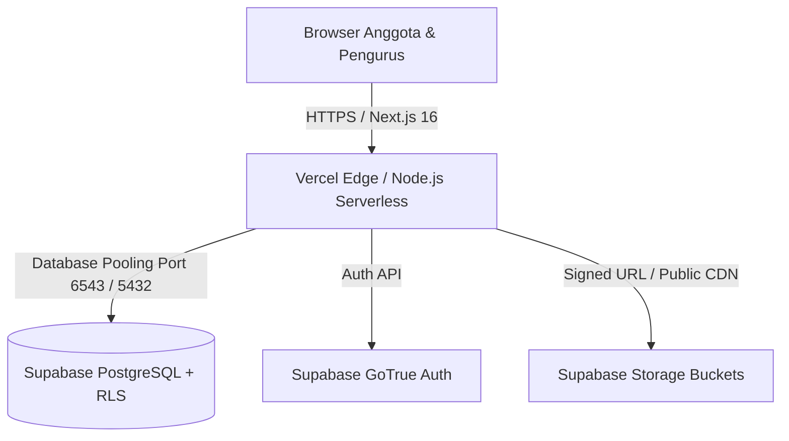

# Panduan Deployment Produksi — Brotherhood Community Portal

Dokumen ini menjelaskan langkah-langkah komprehensif untuk meluncurkan website manajemen komunitas motor **Brotherhood Community Portal** ke lingkungan produksi (Vercel + Supabase Managed PostgreSQL).

---

## 1. Arsitektur Infrastruktur



- **Frontend & App Router API**: Next.js 16 (React 19) di-host di Vercel atau VPS Linux (Docker / Node 20 LTS).
- **Database**: PostgreSQL 15+ dengan ekstensi `pgcrypto` dan fungsi transaksi atomik SQL.
- **Storage**:
  - `proofs` (Private): Menyimpan struk mutasi bank anggota (hanya bisa diakses oleh pengunggah dan Bendahara via Signed URL).
  - `documents` (Private): Menyimpan KTP dan SIM anggota.
  - `gallery` (Public): Menyimpan foto dokumentasi kegiatan touring.

---

## 2. Persiapan Environment Variables

Buat berkas `.env.production` pada server atau tambahkan pada dashboard environment Vercel:

```env
# Next.js Application Environment
NEXT_PUBLIC_APP_URL="https://brotherhood-community.com"
NODE_ENV="production"

# Supabase Production Credentials
NEXT_PUBLIC_SUPABASE_URL="https://your-project-id.supabase.co"
NEXT_PUBLIC_SUPABASE_ANON_KEY="eyJhbGciOiJIUzI1NiIsInR5cCI6IkpXVCJ9..."
SUPABASE_SERVICE_ROLE_KEY="eyJhbGciOiJIUzI1NiIsInR5cCI6IkpXVCJ9..."

# Session & Security Secret
SESSION_SECRET="your-super-long-cryptographic-random-secret-key-32-chars"
```

> [!WARNING]
> Jangan pernah mengekspos `SUPABASE_SERVICE_ROLE_KEY` ke sisi klien (browser). Variabel ini hanya boleh digunakan di lingkungan server untuk operasi administratif berizin tinggi.

---

## 3. Eksekusi Migrasi Database & Seeding

### Langkah A: Jalankan Migrasi Skema
Buka **SQL Editor** pada Supabase Dashboard, lalu jalankan seluruh isi berkas:
- [supabase/migrations/20261015000000_initial_schema.sql](file:///C:/Users/hyunv.DESKTOP-CR0A6HM/Downloads/WEBSITE/Komunitas%20motor/supabase/migrations/20261015000000_initial_schema.sql)

Skema ini akan secara otomatis membuat:
- 22 tabel relasional.
- 7 peran RBAC (`super_admin`, `chairman`, `admin`, `treasurer`, `event_officer`, `moderator`, `member`).
- Row Level Security (RLS) policies untuk mengisolasi data pribadi anggota.
- Fungsi atomik SQL:
  - `generate_member_number()`
  - `register_for_event_atomic()`
  - `approve_event_payment_atomic()`
  - `verify_and_checkin_atomic()`

### Langkah B: Jalankan Data Awal (Seed)
Jalankan berkas [supabase/seed.sql](file:///C:/Users/hyunv.DESKTOP-CR0A6HM/Downloads/WEBSITE/Komunitas%20motor/supabase/seed.sql) untuk menginisialisasi:
- Struktur divisi & jabatan dewan pengurus (*Positions*).
- Akun kas resmi organisasi (Rekening BCA Utama, Mandiri Operasional, dan Kas Tunai).
- Kategori forum resmi dan event touring perdana.

---

## 4. Konfigurasi Supabase Storage Buckets

Pada tab **Storage** di Supabase Dashboard:

1. **Buat Bucket `proofs`**:
   - Status: **Private**
   - File size limit: 5MB
   - Allowed MIME types: `image/jpeg`, `image/png`, `application/pdf`
2. **Buat Bucket `documents`**:
   - Status: **Private**
   - File size limit: 5MB
   - Allowed MIME types: `image/jpeg`, `image/png`, `application/pdf`
3. **Buat Bucket `gallery`**:
   - Status: **Public**
   - File size limit: 10MB
   - Allowed MIME types: `image/jpeg`, `image/png`, `image/webp`

Kebijakan RLS storage telah otomatis dikonfigurasikan di dalam berkas migrasi SQL.

---

## 5. Deployment ke Vercel

1. Buka [Vercel Dashboard](https://vercel.com) dan pilih **Add New Project**.
2. Hubungkan repository GitHub organisasi Anda.
3. Konfigurasi build setting:
   - **Framework Preset**: Next.js
   - **Build Command**: `next build`
   - **Output Directory**: `.next`
   - **Install Command**: `npm install`
4. Masukkan seluruh variabel lingkungan dari bagian 2 di atas.
5. Klik **Deploy**.

---

## 6. Pengaturan Custom Domain & SSL

1. Di dashboard Vercel, masuk ke **Project Settings -> Domains**.
2. Masukkan domain resmi komunitas: `brotherhood-community.com` dan `www.brotherhood-community.com`.
3. Konfigurasikan DNS Record pada registrar domain Anda (Cloudflare, Niagahoster, atau Namecheap):
   - **A Record**: `@` -> `76.76.21.21` (IP Anycast Vercel)
   - **CNAME Record**: `www` -> `cname.vercel-dns.com`
4. Sertifikat SSL Let's Encrypt akan digenerate secara otomatis oleh Vercel dalam waktu 1-5 menit.

---

## 7. Pemeliharaan Berkala & Housekeeping

- **Pencadangan Basis Data**: Supabase Managed Postgres menyediakan Point-in-Time Recovery (PITR) harian otomatis.
- **Pembersihan Token Kedaluwarsa**: Jadwalkan pembersihan token QR lama menggunakan pg_cron atau Webhook berkala:
  ```sql
  DELETE FROM public.attendance_tokens WHERE expires_at < NOW() - INTERVAL '7 days';
  ```
